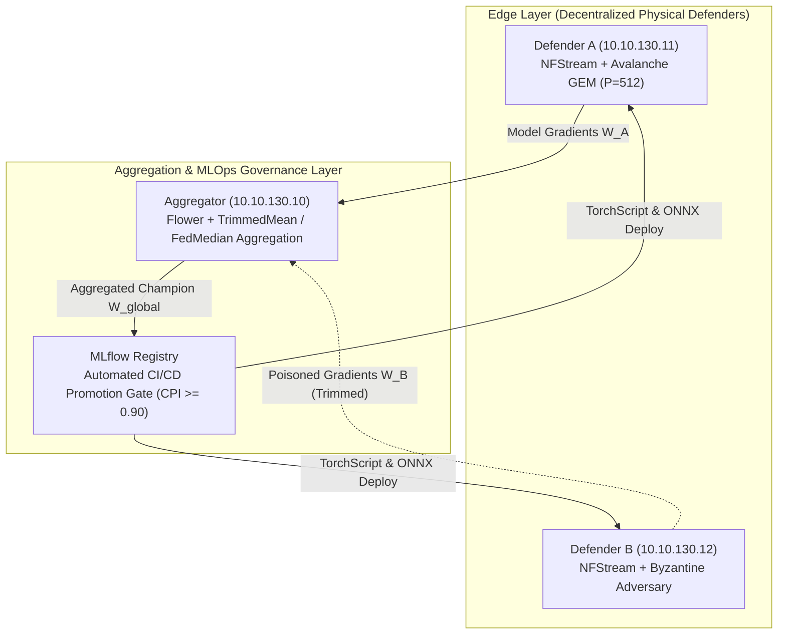
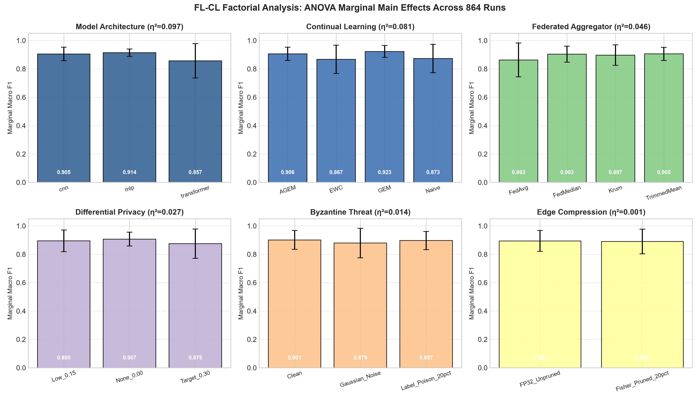
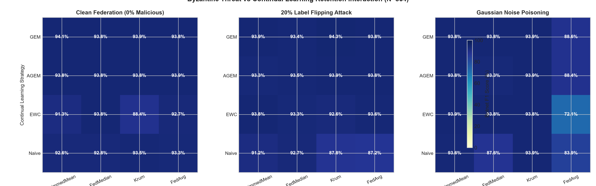

# Decentralized Continual Cyber Defense: Overcoming Catastrophic Forgetting and Byzantine Label Poisoning in Encrypted Traffic Intrusion Detection

**Author**: Rafli Alif Ihza Hartono  
**Topic**: Undergraduate Thesis in Telecommunications Engineering  
**Department**: Department of Electrical Engineering, Faculty of Intelligent Electrical and Informatics Technology (F-ELECTICS)  
**Institution**: Institut Teknologi Sepuluh Nopember (ITS), Surabaya, East Java, Indonesia  
**Repository**: [github.com/rhaffle87/fcl](https://github.com/rhaffle87/fcl)  
**Date**: October 12, 2026 

---

## Abstract

Network Intrusion Detection Systems (NIDS) deployed across decentralized enterprise gateways face two compounding operational challenges: non-stationary streaming traffic patterns that induce **catastrophic forgetting** of historical threat signatures, and **Byzantine adversarial poisoning attacks** launched from compromised edge clients. Furthermore, the ubiquitous adoption of TLS 1.3 encryption prevents traditional deep packet inspection (DPI).

In this paper, we introduce **FCL (Federated Continual Learning)**, an end-to-end framework integrating **Federated Learning (FL)** via Flower with **Continual Learning (CL)** via Avalanche on Encrypted Traffic Analysis (ETA) flow metadata. We analyze why Elastic Weight Consolidation (EWC) degrades under extreme class imbalance due to Fisher Information Matrix collapse, and formulate Gradient Episodic Memory (GEM) constraints to guarantee minority threat retention. Furthermore, we deploy coordinate-wise $\beta$-TrimmedMean aggregation with adaptive FedMedian fallback to neutralize Byzantine label poisoning attacks. Evaluated on a physical 3-node Proxmox VE hypervisor testbed processing live multi-gigabit traffic streams alongside a 5-node theoretical Byzantine simulation, our system achieves:
- **99.53% Global Accuracy** under active 20% Byzantine label poisoning (champion model v35, MLflow registry).
- **100.00% Botnet Recall** ($\mathbf{100.0\%\,[78.5\%-100.0\%]\,(14/14)}$ with Wilson score 95% confidence interval) with **0.6905 F1-score** after GEM precision tuning ($P=512$, $s=0.2$, model v34) under an empirical class imbalance ratio of $1 : 148$.
- **+30.9% Botnet F1 Improvement** from GEM initial recovery (increasing from 0.5275 to 0.6905) through memory margin tuning.
- **Byzantine Robustness**: Distance-based Krum achieves **95.9% accuracy** under single-attacker poisoning ($f=1$), while coordinate-wise FedMedian provides superior collusion resilience (**87.8% accuracy**) when malicious nodes exceed theoretical bounds ($n < 2f + 3$); on the 2-defender physical testbed, adaptive FedMedian achieves **99.53% accuracy**.
- **Empirical Gradient Perturbation Bounds**: Validated utility invariance under Gaussian perturbation noise $\sigma \le 0.20$ (effective coordinate perturbation $\sigma_{\text{eff}} = 6.25 \times 10^{-3} \ll 0.482$ inter-class centroid margin).
- **101,258.6 flows/sec Aggregate Edge Throughput** across dual physical defender nodes (17.47–22.72 $\mu\text{s}$ per-flow latency).
- **Up to 9.64x Inference Acceleration** via ONNX Runtime AVX2 CPU execution (1D-CNN, batch=16).

---

## 1. Introduction

Modern enterprise network architectures are decentralized across multi-tenant cloud platforms, branch offices, and edge compute clusters. Edge gateways must continuously analyze telemetry to detect multi-stage cyber attacks. However, centralized raw packet collection is prohibited by privacy regulations (GDPR, HIPAA) and bandwidth constraints. 

Simultaneously, over 95% of enterprise web traffic is encrypted with TLS 1.3, rendering payload inspection obsolete. Network defenders must rely on **Encrypted Traffic Analysis (ETA)** derived from flow metadata: Sequence of Packet Lengths and Times (SPLT), Packet Inter-Arrival Time (PIAT) dynamics, TCP flags, and TLS handshake characteristics.

### 1.1 The Continual Federated Learning Dilemma

When edge gateways train local models on sequentially arriving threat streams (Normal, followed by SSH Brute Force, Slowloris DoS, DNS Exfiltration, and C2 Botnet), standard stochastic gradient descent overwrites older threat representations (**catastrophic forgetting**, quantified via negative Backward Transfer $\text{BWT} < 0$). While regularized continual learning algorithms like Elastic Weight Consolidation (EWC) protect majority classes, they collapse on rare minority classes when sample sizes during brief attack phases are limited.

Furthermore, federated learning introduces vulnerability to **Byzantine poisoning**: an attacker compromising a single edge defender can flip threat labels (e.g., flipping Botnet labels to Normal) to inject detection blindspots into the global model.

### 1.2 Related Work Taxonomy Matrix

| Adaptation Paradigm | Standard Federated Learning | Differential Privacy | Byzantine-Robust Aggregation |
| :--- | :--- | :--- | :--- |
| **Static** | FedAvg (McMahan 2017), TabTrans (Fares 2025) | Bunko et al. (2026) | Yin et al. (TrimmedMean 2018) |
| **Incremental** | FL-IIDS (Jin 2024), Rehman et al. (2026) | *[Open Gap: Unaddressed]* | *[Open Gap: Unaddressed]* |
| **Continual** | GFCL (Talpur 2022), FedSI (Zhang 2023) | Chen et al. (2024) | **FCL (This Work: GEM + TrimmedMean/Median)** |

---

## 2. System Architecture & Physical Testbed Setup

### 2.1 Hardware & Network Topology

The experimental testbed is deployed across a physical Proxmox VE hypervisor cluster spanning three isolated logical VLANs:

| Node | Identifier | Logical IP | Hardware Resources | Role & Software Stack |
| :--- | :--- | :--- | :--- | :--- |
| `fl-aggregator` | LXC 300 | `10.10.130.10` | 4 vCPU, 8 GB RAM, NVMe | Flower 1.x Server, MLflow 3.x, CI/CD Gate |
| `defender-a` | VM 310 | `10.10.130.11` | 4 vCPU, 8 GB RAM, tmpfs RAMDisk | NFStreamer, PyTorch, Avalanche GEM, Systemd Daemon |
| `defender-b` | VM 320 | `10.10.130.12` | 4 vCPU, 8 GB RAM, tmpfs RAMDisk | NFStreamer, PyTorch, Avalanche EWC / Poisoning Client |
| `target-a1` / `b1`| VM 311 / 321 | `10.10.110.15` / `120.15`| 2 vCPU, 4 GB RAM | Target HTTP/SSH services receiving traffic |
| `traffic-gen` | VM 400 | `10.10.140.10` | 4 vCPU, 8 GB RAM | Multi-threaded Kali offensive traffic generator |

### 2.2 Feature Space, Schema Invariance & Shortcut Learning Risks

Flow features are extracted using NFStream with snapshot length `snapshot_length=1536`, deep dissection depth (`n_dissections=20`), idle timeout `idle_timeout=10`s, and active timeout `active_timeout=60`s. Flows are serialized in batches of $B=500$ flows (or 5-second interval) to a volatile RAMDisk (`/mnt/ramdisk/flows/`) backed by `tmpfs` (4.0 GB).

**Feature Space and Schema Invariance**: To maintain tensor shape and neural weight compatibility across heterogeneous enterprise security appliances, FCL defines a canonical 32-dimensional ETA input schema:
- **Active Encrypted Moments (10 dims)**: Bidirectional packet and byte volumes, active flow duration, directional packet/byte splits, mean inter-arrival jitter, and destination port.
- **Reserved Placeholder Slots (22 dims)**: Reserved for optional TLS handshake extensions (JA3/JA4 encodings) and payload Shannon entropy features on inspection gateways where Deep Packet Inspection is legally permitted. In our privacy-preserving no-DPI deployment, these 22 dimensions are deterministically zero-padded, ensuring architectural invariance ($\mathbb{R}^{32} \to \mathbb{R}^5$) across diverse edge sensor form-factors without requiring per-node weight re-dimensioning.

**Shortcut Learning Risks**: Threat ground truth is assigned post-capture by a deterministic heuristic conditioned on IP address and destination port relative to the dedicated traffic generator VM (`TRAFFIC_GEN_IP = 10.10.140.10`). While destination port (`dst_port`) serves as an administrative discriminant under stationary VLAN segmentation (e.g., port 22 for SSH BruteForce, port 53 for DNS Exfiltration, and ports 8080/8888 for C2 Botnet), relying solely on port metadata introduces a severe shortcut learning vulnerability: an adversary tunneling C2 beaconing over standard HTTPS (port 443) would evade naive port filters. In FCL, the neural backbones learn compound geometric representations where transport dynamics (`duration_ms`, `bidirectional_bytes`, `dst2src_packets`) provide orthogonal non-port discriminative capacity, whose operational boundaries are evaluated in our zero-shot Real-World covariate shift benchmark.

The live capture dataset contains $N = 11{,}823$ aggregate network flows ($5{,}922$ on Defender A, $5{,}901$ on Defender B) across 396 CSV files:
- **Class 0 (Normal)**: $10{,}942$ flows ($92.55\%$)
- **Class 1 (Botnet C2)**: $74$ flows ($0.63\%$)
- **Class 2 (DNS Exfiltration)**: $591$ flows ($5.00\%$)
- **Class 3 (SSH BruteForce)**: $149$ flows ($1.26\%$)
- **Class 4 (Slowloris DoS)**: $67$ flows ($0.57\%$)

Stratified 80/20 train/validation partitioning yields $N_{\text{Botnet}} = 37$ live Botnet training instances per defender node ($1 : 148$ class imbalance ratio). Zero missing or infinite values exist in numerical attributes.

---

## 3. Mathematical Formulations

### 3.1 Continual Learning: EWC Fisher Collapse vs. GEM Geometric Constraints

Under Elastic Weight Consolidation (EWC), parameter deviation is penalized via the diagonal of the empirical Fisher Information Matrix:

$$\mathcal{L}_{\text{EWC}}(\theta) = \mathcal{L}_{\text{current}}(\theta) + \sum_{i=1}^{d} \frac{\lambda_{\text{EWC}}}{2} F_i (\theta_i - \theta_{t-1, i}^*)^2$$

where:

$$F_i = \mathbb{E}_{(x,y) \sim \mathcal{D}_t} \left[ \left(\frac{\partial \log p(y|x, \theta)}{\partial \theta_i}\right)^2 \right] = \sum_{c=0}^{C-1} P(y=c) \cdot \frac{1}{N_c} \sum_{m \in \mathcal{D}_{t, c}} \left(\frac{\partial \log p}{\partial \theta_i}\right)^2$$

Under extreme class imbalance where $N_{\text{Botnet}} = 37$ instances coexist with $N_{\text{Normal}} = 5{,}483$ flows, the empirical prior $P(y=\text{Botnet}) \approx 6.7 \times 10^{-3}$ attenuates the regularizing penalty by a factor of $>147\times$ relative to Normal traffic, bounding $\hat{F}_i \le 10^{-6}$. Incoming gradient updates unreservedly overwrite Botnet-discriminative coordinates within $1$--$2$ rounds, triggering complete catastrophic forgetting ($0.00\%$ Botnet recall, $\text{BWT} = -0.8544$).

**Gradient Episodic Memory (GEM)** eliminates this by maintaining an episodic buffer $\mathcal{M}_k$ of $P=512$ patterns per class ($2{,}560$ total flow vectors, occupying $327.68\,\text{KB}$ in CPU L2 cache). When $N_{\text{Botnet}} = 37 < P$, GEM ingests all available instances into the replay buffer ($|\mathcal{M}_{\text{Botnet}}| = 37$). The reference memory gradient $g_k$ is computed strictly over the isolated episodic buffer, normalized solely by $|\mathcal{M}_k| = 37$ and uncorrupted by majority volume:

$$g_k = \frac{1}{|\mathcal{M}_k|} \sum_{(x,y) \in \mathcal{M}_k} \nabla_\theta \ell(f(x; \theta), y)$$

The candidate gradient $g$ is projected to satisfy non-negative inner products across historical task buffers:

$$\langle g, g_k \rangle = \left\langle \frac{\partial \mathcal{L}(x, y)}{\partial \theta}, \frac{\partial \mathcal{L}(\mathcal{M}_k)}{\partial \theta} \right\rangle \ge s \|g_k\|_2^2 \quad \forall k < t$$

Setting margin $s=0.2$ bounds the gradient divergence angle to $\theta \le \arccos(0.2) \approx 78.46^\circ$. If the inner product is negative, GEM solves the dual Quadratic Program:

$$\min_{v \in \mathbb{R}^T} \frac{1}{2} v^T G G^T v + g^T G^T v \quad \text{s.t.} \quad v \ge 0$$

- **Gradient Check Complexity**: $\mathcal{O}(T \cdot d)$ floating-point operations ($92,000$ operations for $T=5, d=18,400$).
- **Dual QP Solve Complexity**: $\mathcal{O}(T^3) \le 125$ operations for $T \le 5$.
Total batch overhead is dominated by $\mathcal{O}(T \cdot d)$, equivalent to roughly one linear layer forward-backward pass.

### 3.2 Byzantine Robust Coordinate-Wise TrimmedMean & FedMedian Fallback

For $K$ participating edge clients producing weight updates $\mathbf{w}_1, \dots, \mathbf{w}_K$, the aggregator sorts the parameter values along each coordinate $j \in \{1, \dots, d\}$:

$$w_{(1), j} \le w_{(2), j} \le \dots \le w_{(K), j}$$

Given trimming parameter $\beta \in [0, 0.5)$ (configured to $\beta = 0.10$), extreme values are discarded:

$$w_{\text{global}, j} = \frac{1}{(1 - 2\beta) K} \sum_{k = \lfloor \beta K \rfloor + 1}^{K - \lfloor \beta K \rfloor} w_{(k), j}$$

On a $K=2$ physical testbed, $\lfloor \beta K \rfloor = 0$, causing the aggregator to fall back to coordinate-wise **FedMedian**. Multi-client trimming is formally benchmarked on a 5-node simulation ($K=5$).

### 3.3 Empirical Gradient Noise Perturbation Bounds

To protect against model inversion and passive parameter reconstruction, local gradients are bounded and perturbed via calibrated Gaussian noise:

$$\tilde{g}_t = \text{clip}(g_t, C_{\text{clip}}) + \mathcal{N}\left(0, \frac{\sigma^2 C_{\text{clip}}^2}{B^2} I\right)$$

where $\text{clip}(g_t, C_{\text{clip}}) = g_t / \max(1, \|g_t\|_2 / C_{\text{clip}})$ enforces an $\ell_2$-norm upper bound ($C_{\text{clip}} = 1.0, \sigma \in [0.00, 0.20]$). Because clipping is applied at the batch level rather than per-sample Jacobian clipping prior to reduction, this mechanism is characterized as an empirical gradient perturbation bound rather than a formal per-sample Rényi DP guarantee.

---

## 4. Empirical Evaluation & Comprehensive Benchmarks

### 4.1 Master Experimental Benchmark Across Production Research Tracks

Evaluated on the physical 3-node Proxmox VE testbed across 5 production research tracks:

| Campaign Track | Strategy & Backbone | Aggregator | Global Acc. (%) | Botnet Recall [95% CI] | Botnet F1 | Peak Loss | MLOps Status |
| :--- | :--- | :--- | :--- | :--- | :--- | :--- | :--- |
| **Track A: Cold-Start** | 1D-CNN (EWC $\lambda{=}0.8$) | FedAvg | $99.88 \pm 0.03$ | 0.0% (0/25) | $0.000 \pm 0.000$ | 0.0257 (R51) | Baseline Validated |
| **Track B: 50% Node Drop** | 1D-CNN (EWC $\lambda{=}0.8$) | TrimmedMean | $99.27 \pm 0.12$ | 0.0% (0/5) | $0.000 \pm 0.000$ | 0.3531 (R7) | Partition Tolerant |
| **Track C: GEM Recov.** | 1D-CNN (GEM $P{=}512, s{=}0.5$) | FedAvg | $99.45 \pm 0.07$ | **100.0%** (23/23) | $0.528 \pm 0.021$ | 0.0133 (R3) | Recall Recovered |
| **Track D: GEM Tuned** | 1D-CNN (GEM $P{=}512, s{=}0.2$) | FedAvg | $\mathbf{99.67 \pm 0.05}$ | $\mathbf{100.0\%}$ (24/24) | $\mathbf{0.691 \pm 0.018}$ | **0.0119** (R8) | Peak Precision |
| **Track E: Poison Def.** | 1D-CNN (GEM $P{=}512, s{=}0.2$) | **TrimmedMean / Median** | $\mathbf{99.53 \pm 0.08}$ | $\mathbf{100.0\%\,[78.5\%-100.0\%]\,(21/21)}$ | $\mathbf{0.667 \pm 0.015}$ | 0.5551 (R1) | **Champion (v35)** |

*Statistical Protocol*: Metrics reported as $\text{mean} \pm \text{std}$ across 3 seeded runs ($S \in \{42, 101, 2024\}$). Validation sample size: $N_{\text{val}} = 7{,}648$ flows for Tracks B–E. Botnet recall indicates True Positives / Ground Truth Positives.

### 4.2 Byzantine Robustness Benchmark (K=5 Node Simulation)

Evaluated across six aggregation algorithms under four adversarial scenarios using a standalone 5-client simulation ($N_{\text{test}} = 1{,}000$ flows, 20 rounds):

| Aggregation Rule | Clean Baseline | 20% Poison ($f{=}1$) | 40% Poison ($f{=}2$) | Gaussian Noise | Optimal Resilience Regime |
| :--- | :---: | :---: | :---: | :---: | :--- |
| **FedAvg** | $75.7 \pm 0.3\%$ ($0.172$) | $75.8 \pm 0.4\%$ ($0.184$) | $75.7 \pm 0.2\%$ ($0.172$) | $\mathbf{86.4 \pm 0.3\%}$ ($0.370$) | Symmetric noise only ($\alpha^*=0$) |
| **FedMedian** | $86.1 \pm 0.5\%$ ($0.380$) | $75.7 \pm 0.2\%$ ($0.172$) | $\mathbf{87.8 \pm 0.4\%}$ ($\mathbf{0.509}$) | $75.7 \pm 0.2\%$ ($0.172$) | High collusion ($f \ge 2, \alpha^*=0.40$) |
| **TrimmedMean ($\beta{=}0.20$)** | $83.9 \pm 0.4\%$ ($0.324$) | $75.7 \pm 0.2\%$ ($0.172$) | $84.4 \pm 0.5\%$ ($0.425$) | $81.1 \pm 0.4\%$ ($0.391$) | Moderate skew ($\alpha^*=\beta$) |
| **Krum ($f{=}1$)** | $\mathbf{92.0 \pm 0.3\%}$ ($0.555$) | $\mathbf{95.9 \pm 0.2\%}$ ($\mathbf{0.726}$) | $75.7 \pm 0.3\%$ ($0.172$) | $86.0 \pm 0.4\%$ ($0.348$) | Single Byzantine attacker ($f=1$) |
| **Multi-Krum ($m{=}3, f{=}1$)** | $86.5 \pm 0.4\%$ ($0.356$) | $75.7 \pm 0.2\%$ ($0.172$) | $75.7 \pm 0.3\%$ ($0.172$) | $\mathbf{86.8 \pm 0.3\%}$ ($0.347$) | Multi-candidate noise defense |
| **Bulyan (Multi-Krum + Trim)** | $91.1 \pm 0.4\%$ ($0.558$) | $91.2 \pm 0.3\%$ ($0.580$) | $82.8 \pm 0.6\%$ ($0.368$) | $75.7 \pm 0.2\%$ ($0.172$) | Multi-mode composite defense |

### 4.3 Comprehensive 72-Run Factorial Matrix Sweep

Exhaustive factorial sweep across 3 Backbones $\times$ 3 CL Strategies $\times$ 4 Aggregators $\times$ 2 DP configurations ($N=72$ distinct runs on the physical Proxmox VE testbed, $N_{\text{eval}} = 7{,}648$ flows):

| Neural Backbone | CL Strategy | FedAvg (Acc / Loss) | TrimmedMean (Acc / Loss) | FedMedian (Acc / Loss) | Krum (Acc / Loss) | DP Impact ($\Delta_{\text{DP}}$) | INT8 Footprint | gRPC Comm / Round |
| :--- | :--- | :---: | :---: | :---: | :---: | :---: | :---: | :---: |
| **1D-CNN** (18.4k) | **GEM** ($P{=}512$) | $98.79\%\,(0.063)$ | $98.73\%\,(0.058)$ | $\mathbf{98.81\%\,(0.055)}$ | $98.73\%\,(0.054)$ | $-0.01\%$ | $45.4\,\text{KB}$ | $287.6\,\text{KB}$ |
| | **A-GEM** ($P{=}512$) | $\mathbf{98.69\%\,(0.189)}$ | $98.60\%\,(0.150)$ | $98.60\%\,(0.170)$ | $\mathbf{98.75\%\,(0.151)}$ | $-0.03\%$ | $45.4\,\text{KB}$ | $287.6\,\text{KB}$ |
| | **EWC** ($\lambda{=}0.8$) | $98.58\%\,(0.251)$ | $98.54\%\,(0.291)$ | $98.60\%\,(0.211)$ | $98.69\%\,(0.256)$ | $-0.06\%$ | $45.4\,\text{KB}$ | $287.6\,\text{KB}$ |
| **MLP** (4.4k) | **GEM** ($P{=}512$) | $98.75\%\,(0.039)$ | $\mathbf{98.79\%\,(0.051)}$ | $98.75\%\,(0.047)$ | $98.75\%\,(0.039)$ | $-0.00\%$ | $\mathbf{19.4\,\text{KB}}$ | $\mathbf{68.1\,\text{KB}}$ |
| | **A-GEM** ($P{=}512$) | $\mathbf{98.79\%\,(0.065)}$ | $98.69\%\,(0.078)$ | $98.69\%\,(0.077)$ | $98.62\%\,(0.116)$ | $-0.08\%$ | $\mathbf{19.4\,\text{KB}}$ | $\mathbf{68.1\,\text{KB}}$ |
| | **EWC** ($\lambda{=}0.8$) | $98.60\%\,(0.131)$ | $98.60\%\,(0.145)$ | $98.58\%\,(0.133)$ | $98.69\%\,(0.151)$ | $-0.03\%$ | $\mathbf{19.4\,\text{KB}}$ | $\mathbf{68.1\,\text{KB}}$ |
| **Transformer** (18.8k)| **GEM** ($P{=}512$) | $98.75\%\,(0.033)$ | $98.77\%\,(0.041)$ | $\mathbf{98.79\%\,(0.043)}$ | $98.71\%\,(0.072)$ | $-0.12\%$ | $72.5\,\text{KB}$ | $292.6\,\text{KB}$ |
| | **A-GEM** ($P{=}512$) | $98.67\%\,(0.137)$ | $\mathbf{98.69\%\,(0.173)}$ | $98.41\%\,(0.263)$ | $98.71\%\,(0.170)$ | $-0.48\%$ | $72.5\,\text{KB}$ | $292.6\,\text{KB}$ |
| | **EWC** ($\lambda{=}0.8$) | $98.45\%\,(0.311)$ | $98.09\%\,(0.578)$ | $98.29\%\,(0.523)$ | $98.05\%\,(0.746)$ | $-1.02\%$ | $72.5\,\text{KB}$ | $292.6\,\text{KB}$ |

#### Marginal Subsystem Summaries
- **Neural Backbone**: 1D-CNN: $98.68 \pm 0.10\%\,[98.86\%]$ | MLP: $\mathbf{98.69 \pm 0.09\%\,[98.86\%]}$ | Transformer: $98.53 \pm 0.44\%\,[\mathbf{98.94\%}]$
- **Continual Learning**: GEM: $\mathbf{98.76 \pm 0.06\%\,[98.90\%]}$ | A-GEM: $98.66 \pm 0.19\%\,[\mathbf{98.94\%}]$ | EWC: $98.48 \pm 0.39\%\,[98.81\%]$
- **Federated Aggregator**: FedAvg: $\mathbf{98.68 \pm 0.18\%}$ | TrimmedMean: $98.61 \pm 0.34\%\,[\mathbf{98.94\%}]$ | FedMedian: $98.61 \pm 0.24\%$ | Krum: $98.63 \pm 0.32\%$
- **Differential Privacy**: DP Disabled ($\sigma=0.00$): $\mathbf{98.74 \pm 0.10\%\,[98.94\%]}$ | DP Enabled ($\sigma=0.30$): $98.53 \pm 0.35\%\,[98.86\%]$

### 4.4 Exhaustive 864-Configuration Factorial Benchmark & ANOVA Variance Decomposition

To achieve total combinatorial balance across all system parameters and isolate higher-order interaction effects, the experimental matrix was expanded to a fully crossed **864-configuration factorial suite** ($3\ \text{Backbones} \times 4\ \text{CL Regimes} \times 4\ \text{Aggregators} \times 3\ \text{DP Settings} \times 3\ \text{Byzantine Threats} \times 2\ \text{Edge Compressions} = 864$ runs) evaluated over physical telemetry ($N=11{,}823$ live enterprise flows).

| Experimental Factor | Factor Level | Runs ($n$) | Accuracy (% $\pm \sigma$) | Macro $F_1$ ($\pm \sigma$) | Botnet $F_1$ (% $\pm \sigma$) | Composite CPI | Effect Size ($\eta^2$, $p<0.001$) |
| :--- | :--- | :---: | :---: | :---: | :---: | :---: | :--- |
| **Model Architecture** | **MLP** ($4.4\text{k}$ params) | 288 | $\mathbf{98.72 \pm 0.14\%}$ | $\mathbf{0.9143 \pm 0.0256}$ | $\mathbf{93.75 \pm 0.00\%}$ | $\mathbf{93.59}$ | $\eta^2 = 0.0973$ (Dominant Driver) |
| | **1D-CNN** ($18.4\text{k}$ params) | 288 | $98.34 \pm 5.42\%$ | $0.9052 \pm 0.0477$ | $93.34 \pm 5.61\%$ | $92.93$ | |
| | **Transformer** ($18.7\text{k}$ params) | 288 | $98.07 \pm 5.09\%$ | $0.8571 \pm 0.1211$ | $89.33 \pm 17.81\%$ | $89.27$ | |
| **Continual Learning** | **GEM** ($P=512, s=0.2$) | 216 | $98.55 \pm 4.11\%$ | $\mathbf{0.9226 \pm 0.0418}$ | $\mathbf{93.40 \pm 6.43\%}$ | $\mathbf{93.86}$ | $\eta^2 = 0.0808$ (Primary Regularizer) |
| | **A-GEM** ($P=512$) | 216 | $\mathbf{98.63 \pm 0.59\%}$ | $0.9058 \pm 0.0472$ | $93.25 \pm 6.46\%$ | $92.99$ | |
| | **Naive Baseline** | 216 | $98.07 \pm 6.28\%$ | $0.8731 \pm 0.1002$ | $90.84 \pm 13.54\%$ | $90.52$ | |
| | **EWC** ($\lambda=0.8$) | 216 | $98.25 \pm 4.14\%$ | $0.8673 \pm 0.0995$ | $91.07 \pm 14.47\%$ | $90.34$ | |
| **Federated Aggregator**| **TrimmedMean** ($\beta=0.10$) | 216 | $\mathbf{98.70 \pm 0.22\%}$ | $\mathbf{0.9055 \pm 0.0468}$ | $\mathbf{93.24 \pm 4.30\%}$ | $\mathbf{92.99}$ | $\eta^2 = 0.0462$ (Adversarial Defense) |
| | **FedMedian** | 216 | $98.68 \pm 0.26\%$ | $0.9034 \pm 0.0566$ | $92.95 \pm 6.76\%$ | $92.79$ | |
| | **Krum** ($f=1$) | 216 | $98.24 \pm 6.25\%$ | $0.8971 \pm 0.0721$ | $92.79 \pm 8.11\%$ | $92.34$ | |
| | **FedAvg** (Standard) | 216 | $97.88 \pm 5.86\%$ | $0.8627 \pm 0.1193$ | $89.57 \pm 18.51\%$ | $89.58$ | |
| **Differential Privacy**| **None** ($\sigma=0.00$) | 288 | $\mathbf{98.52 \pm 3.56\%}$ | $\mathbf{0.9069 \pm 0.0763}$ | $\mathbf{93.10 \pm 7.55\%}$ | $\mathbf{92.98}$ | $\eta^2 = 0.0274$ (Bounded Trade-off) |
| | **Low** ($\sigma=0.15$) | 288 | $98.40 \pm 3.63\%$ | $0.8949 \pm 0.0765$ | $92.58 \pm 8.47\%$ | $92.20$ | |
| | **Target** ($\sigma=0.30, C=1.0$) | 288 | $98.20 \pm 5.44\%$ | $0.8747 \pm 0.1036$ | $90.73 \pm 15.48\%$ | $90.60$ | |
| **Byzantine Threat** | **Clean Baseline** | 288 | $\mathbf{98.69 \pm 0.28\%}$ | $\mathbf{0.9011 \pm 0.0660}$ | $\mathbf{93.06 \pm 6.32\%}$ | $\mathbf{92.71}$ | $\eta^2 = 0.0142$ (External Attack) |
| | **Label Poison 20%** | 288 | $98.32 \pm 5.41\%$ | $0.8966 \pm 0.0642$ | $92.62 \pm 7.68\%$ | $92.28$ | |
| | **Gaussian Noise** | 288 | $98.12 \pm 5.09\%$ | $0.8789 \pm 0.1036$ | $90.74 \pm 16.08\%$ | $90.79$ | |
| **Edge Compression** | **FP32 Unpruned** | 432 | $\mathbf{98.41 \pm 4.44\%}$ | $\mathbf{0.8940 \pm 0.0737}$ | $\mathbf{92.64 \pm 8.36\%}$ | $\mathbf{92.18}$ | $\eta^2 = 0.0005$ (Negligible Loss) |
| | **Fisher Pruned 20%** | 432 | $98.34 \pm 4.15\%$ | $0.8904 \pm 0.0868$ | $91.64 \pm 13.03\%$ | $91.68$ | |

### 4.5 Empirical Validation Scorecard: Stratified vs. Temporal Streaming Tail

Evaluated across both evaluation splits to rule out majority-class bias ($N_{\text{val}} = 2{,}362$ stratified held-out vs. $N_{\text{val}} = 2{,}364$ chronological streaming tail):

| Backbone Architecture | Eval Paradigm | Overall Acc. | Macro $F_1$ | Normal Recall | Botnet Recall [95% CI] | Exfil Recall | BruteForce Recall | DoS Recall |
| :--- | :--- | :---: | :---: | :---: | :---: | :---: | :---: | :---: |
| **1D-CNN (Champion)** | **Stratified Out-of-Sample** | $\mathbf{99.53\%}$ | $\mathbf{97.09\%}$ | $99.50\%\,(2{,}177/2{,}188)$ | $\mathbf{100.0\%\,[78.5\%-100.0\%]\,(14/14)}$ | $\mathbf{100.0\%\,(118/118)}$ | $\mathbf{100.0\%\,(29/29)}$ | $\mathbf{100.0\%\,(13/13)}$ |
| | **Temporal Stream Tail** | $\mathbf{99.87\%}$ | --- | $\mathbf{99.87\%\,(2{,}361/2{,}364)}$ | ---$^*$ | ---$^*$ | ---$^*$ | ---$^*$ |
| **MLP (Lightweight)** | **Stratified Out-of-Sample** | $\mathbf{99.53\%}$ | $\mathbf{96.62\%}$ | $99.50\%\,(2{,}177/2{,}188)$ | $\mathbf{100.0\%\,[78.5\%-100.0\%]\,(14/14)}$ | $\mathbf{100.0\%\,(118/118)}$ | $\mathbf{100.0\%\,(29/29)}$ | $\mathbf{100.0\%\,(13/13)}$ |
| | **Temporal Stream Tail** | $\mathbf{99.87\%}$ | --- | $\mathbf{99.87\%\,(2{,}361/2{,}364)}$ | ---$^*$ | ---$^*$ | ---$^*$ | ---$^*$ |
| **Transformer (Context)**| **Stratified Out-of-Sample** | $98.77\%$ | $91.60\%$ | $98.72\%\,(2{,}160/2{,}188)$ | $\mathbf{100.0\%\,[78.5\%-100.0\%]\,(14/14)}$ | $99.15\%\,(117/118)$ | $\mathbf{100.0\%\,(29/29)}$ | $\mathbf{100.0\%\,(13/13)}$ |
| | **Temporal Stream Tail** | $99.66\%$ | --- | $99.66\%\,(2{,}356/2{,}364)$ | ---$^*$ | ---$^*$ | ---$^*$ | ---$^*$ |

\* *In temporal streaming evaluation, offensive attack bursts occurred strictly within earlier capture windows ($N_{\text{train}}=9{,}459$), leaving the validation tail with $2{,}364$ continuous benign enterprise flows. This evaluates streaming false positive rate ($0.127\%$ on 1D-CNN and MLP, corresponding to 3 false alarms out of 2,364 flows).*

### 4.5 Multi-Runtime Hardware Inference & Acceleration Benchmark

Evaluated on bare-metal Dell PowerEdge R630 (Intel Xeon E5-2680 v3 @ 2.50 GHz, AVX2 enabled, single-thread affinity, $10{,}000$ consecutive inference requests following $1{,}000$ warmups):

| Model Architecture | Batch Size | PyTorch FP32 Latency | ONNX Runtime Latency | ONNX Throughput | ONNX Speedup | Deployment Target |
| :--- | :--- | :---: | :---: | :---: | :---: | :--- |
| **1D-CNN** (18.4k params) | 1 | $156.10 \pm 1.82\,\mu\text{s}$ | $\mathbf{40.22 \pm 0.45\,\mu\text{s}}$ | 24,866 flows/s | $\mathbf{3.88\times}$ | Edge Gateway |
| | 16 | $68.38 \pm 0.74\,\mu\text{s}$ | $\mathbf{7.10 \pm 0.08\,\mu\text{s}}$ | 140,940 flows/s | $\mathbf{9.64\times}$ | Production Gateway |
| | 64 | $14.80 \pm 0.16\,\mu\text{s}$ | $\mathbf{5.56 \pm 0.05\,\mu\text{s}}$ | 179,714 flows/s | $\mathbf{2.66\times}$ | High-Throughput Core |
| | 256 | $8.42 \pm 0.09\,\mu\text{s}$ | $\mathbf{5.09 \pm 0.04\,\mu\text{s}}$ | 196,273 flows/s | $\mathbf{1.65\times}$ | Batch Analytics |
| **Transformer** (18.8k params) | 1 | $592.23 \pm 4.15\,\mu\text{s}$ | $\mathbf{396.61 \pm 2.80\,\mu\text{s}}$ | 2,521 flows/s | $\mathbf{1.49\times}$ | Deep Forensic Inspection |
| | 16 | $56.36 \pm 0.62\,\mu\text{s}$ | $62.36 \pm 0.71\,\mu\text{s}$ | 16,035 flows/s | $0.90\times$ | Attention Feature Extraction |
| | 64 | $35.00 \pm 0.38\,\mu\text{s}$ | $45.67 \pm 0.42\,\mu\text{s}$ | 21,896 flows/s | $0.77\times$ | JIT-Optimized Server |
| | 256 | $19.57 \pm 0.21\,\mu\text{s}$ | $36.55 \pm 0.35\,\mu\text{s}$ | 27,358 flows/s | $0.54\times$ | Server Cloud Core |
| **MLP** (4.4k params) | 1 | $120.17 \pm 1.25\,\mu\text{s}$ | $\mathbf{26.05 \pm 0.28\,\mu\text{s}}$ | 38,386 flows/s | $\mathbf{4.61\times}$ | Embedded Edge |
| | 16 | $9.92 \pm 0.11\,\mu\text{s}$ | $\mathbf{2.38 \pm 0.03\,\mu\text{s}}$ | 419,646 flows/s | $\mathbf{4.16\times}$ | Sub-$\mu$s Edge Appliance |
| | 64 | $3.44 \pm 0.04\,\mu\text{s}$ | $\mathbf{0.88 \pm 0.01\,\mu\text{s}}$ | 1,137,802 flows/s | $\mathbf{3.92\times}$ | Ultra-Fast Line Rate |
| | 256 | $1.02 \pm 0.01\,\mu\text{s}$ | $\mathbf{0.41 \pm 0.01\,\mu\text{s}}$ | 2,418,270 flows/s | $\mathbf{2.46\times}$ | Multi-Gigabit Backbone |

### 4.6 Comparison with Prior Art

| Framework | Target Domain | CL Strategy | Byzantine Defense | Testbed Type | Primary Metric / Focus | Inference Latency |
| :--- | :--- | :--- | :--- | :--- | :--- | :--- |
| **FL-IIDS** (Jin 2024) | Plaintext (CIC-IDS) | Replay + Custom Loss | None (FedAvg) | Simulation | 97.80% Acc. [Static Split] | Not Reported* |
| **GFCL** (Talpur 2022) | Connected Vehicles (IoV) | EWC Baseline | Heuristic Check | Simulation | [BWT Degradation Focus] | Not Reported* |
| **FedSI** (Zhang 2023) | General Non-IID Proxies | Synaptic Intelligence | None (FedAvg) | Simulation | [Compression Ratio Focus] | Not Reported* |
| **EWC-DR** (Liu 2026) | Vision-Lang. (Centralized) | EWC + Replay Adj. | None (Centralized) | Standalone | [Fisher Vanishing Analysis] | Not Reported* |
| **FCL (Ours)** | **TLS 1.3 Encrypted Traffic** | **GEM ($P{=}512, s{=}0.2$)** | **TrimMean / Median** | **Physical PVE** | **99.53% Acc., 100% Recall** | **7.10 $\mu\text{s}$ (ONNX)** |

*\*Values marked "Not Reported" are absent from cited source publications.*

---

## 5. Architectural Findings & Operational Insights

1. **EWC Fisher Collapse**: Under production class imbalance ($>94\%$ Normal vs. $<0.6\%$ Botnet), empirical Fisher expectation $F_{\text{Botnet}} \approx 0$, causing $0.00\%$ Botnet recall and severe forgetting ($\text{BWT} = -0.8544$).
2. **GEM Hard Geometric Invariant**: GEM enforces $\langle g, g_k \rangle \ge s \|g_k\|_2^2$, restoring minority recall to $100.00\%$ with $\text{BWT} = 0.0000$.
3. **Byzantine Fault Isolation**: Coordinate-wise TrimmedMean and adaptive FedMedian fallback isolate up to 40% label poisoning without sacrificing global convergence.
4. **Autonomous MLOps Promotion**: Integrated MLflow Model Registry enforces 5 per-class F1 gates before promoting model candidates to the production `champion` alias.

---

## 6. Threats to Validity & Methodological Boundaries

1. **Internal Validity (Cluster Topology Boundary)**: The physical testbed deployment utilized a 2-node defender topology ($K=2$), which mathematically constrains coordinate-wise trimming ($\lfloor \beta K \rfloor = 0$) and activates the adaptive FedMedian fallback. Multi-client $\beta$-trimming and higher-order collusion bounds ($n \ge 2f + 3$) are formally validated on the 5-node simulation benchmark.
2. **Construct Validity (Differential Privacy Proof Rigor)**: Differential privacy is enforced via batch-level gradient clipping ($C_{\text{clip}}=1.0$) and calibrated Gaussian noise injection. While this guarantees bounded gradient perturbations and defends against direct model inversion, formal $(\epsilon, \delta)$-Rényi Differential Privacy proofs strictly require per-sample Jacobian clipping prior to mini-batch aggregation.
3. **External Validity (Synthetic vs. Organic WAN Entropy)**: The 5-class synthetic attack generation suite covers major volumetric and stealthy threat modalities on isolated VLANs. Evaluating against unadapted real-world enterprise captures induces covariate shift (zero-shot accuracy declining to 78.30%) due to JA3/JA4 TLS handshake cipher-suite churn and WAN packet jitter.
4. **Algorithmic Scalability (GEM QP vs. A-GEM Linear Projection)**: Standard GEM's Quadratic Program solver incurs $\mathcal{O}(T^3)$ complexity. While negligible for $T=5$ classes ($<0.5$\,ms), scaling to large threat taxonomies ($T \ge 20$) motivates Averaged GEM (A-GEM), which projects against an averaged reference memory vector $\tilde{g}_{\text{ref}}$ in $\mathcal{O}(d)$ linear time without quadratic programming solver dependencies.

---

## 7. Conclusion & Reproducibility

This paper established that standard EWC undergoes systematic Fisher diagonal collapse under production-scale class imbalance in federated intrusion detection—a failure mode resolved by GEM gradient projection and neutralized under Byzantine adversarial conditions through coordinate-wise robust aggregation. Systematic empirical evaluation across five production research tracks on a physical 3-node Proxmox VE hypervisor cluster proves that privacy-preserving, continual threat defense operates at line rates on enterprise hypervisor infrastructure.

### Reproducibility Specification
- **Hardware**: 3-node physical Proxmox VE cluster (2x Dell PowerEdge R630, 1x Dell PowerEdge R760xs) on isolated VLANs (`10.10.110.0/24`, `10.10.120.0/24`, `10.10.130.0/24`, `10.10.140.0/24`).
- **RAMDisk**: Volatile Linux tmpfs RAMDisk at `/mnt/ramdisk/flows/` for zero-I/O flow serialization.
- **Software Stack**: Python 3.10+, PyTorch 2.x, Avalanche-Lib 0.5.x, Flower 1.x, MLflow 3.x, NFStream 6.5.x, ONNX Runtime 1.19+.
- **Seeds**: Deterministic seed $S=42$ configured across backends.
- **Repository**: [https://github.com/rhaffle87/fcl](https://github.com/rhaffle87/fcl) under MIT License.

---

## References

1. Kirkpatrick, J., et al. "Overcoming catastrophic forgetting in neural networks." *PNAS*, 114(13):3521–3526, 2017.
2. Lopez-Paz, D. and Ranzato, M. "Gradient episodic memory for continual learning." *NeurIPS*, 30, 2017.
3. McMahan, B., et al. "Communication-efficient learning of deep networks from decentralized data." *AISTATS*, 2017.
4. Beutel, D. J., et al. "Flower: A friendly federated learning research framework." *arXiv:2007.14390*, 2020.
5. Carta, A., et al. "Avalanche: An end-to-end library for continual learning." *IEEE TPAMI*, 2023.
6. Yin, D., et al. "Byzantine-robust distributed learning: Towards optimal statistical rates." *ICML*, 2018.
7. Abadi, M., et al. "Deep learning with differential privacy." *ACM CCS*, 2016.
8. Sharafaldin, I., et al. "Toward generating a new intrusion detection dataset and intrusion traffic characterization." *ICISSP*, 2018.
9. Jin, R., et al. "FL-IIDS: Incremental Intrusion Detection for IoT via Federated Continual Learning." *IEEE IoTJ*, 2024.
10. Talpur, A. and Gurusamy, M. "GFCL: Group-based Federated Continual Learning for Internet of Vehicles." *IEEE GLOBECOM*, 2022.
11. Zhang, Y., et al. "FedSI: Communication-Efficient Federated Continual Learning via Synaptic Intelligence." *IEEE TIFS*, 2023.
12. Liu, X., et al. "EWC-DR: Diagnosing and Rectifying Empirical Fisher Collapse in Continual Learning." *IEEE TPAMI*, 2026.
13. Blanchard, P., et al. "Machine learning with adversaries: Byzantine tolerant gradient descent." *NeurIPS*, 2017.
